# How the benchmark works

How a run is driven, how load is generated, the life of one tool call through
each way of getting a sandbox, and a measured timeline of one worker's calls.

## 1. How a run is driven

`harness/run-matrix.sh` runs on your machine and drives everything through
`kubectl`. Each cell of the grid runs inside the cluster, detached, so a dropped
`kubectl exec` connection can't lose it.

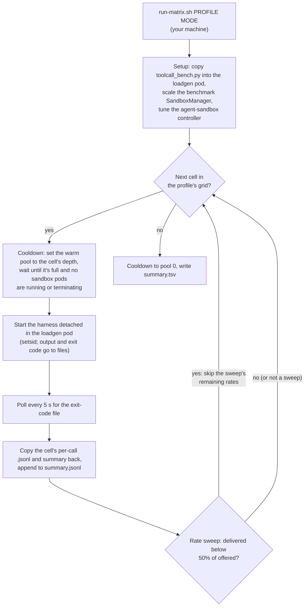

## 2. How load is generated

The harness runs in the `loadgen` pod in `toolcall-loadgen`. It splits the
workers (closed loop), the calls (burst) or the arrival rate (open loop) across
several processes, each an asyncio event loop. Every worker reads its tool
durations from its own seeded random sequence, so worker *k*'s *i*-th call
sleeps the same time in every arm.

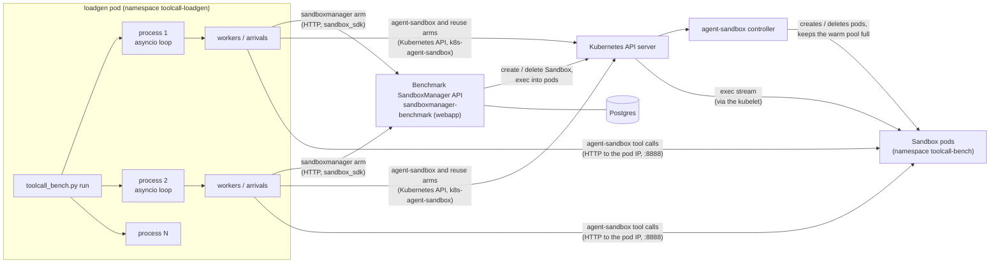

The three load modes:

| Mode | What drives it | Measures |
|---|---|---|
| Closed loop | W workers, each starting its next call as soon as the last finishes | Throughput and latency at a fixed concurrency |
| Burst | N calls started at the same instant | How fast a fan-out is absorbed (e.g. against a pool of N) |
| Open loop | Poisson arrivals at R calls/s, capped at MAX_INFLIGHT in flight | How delivered throughput degrades as offered load passes what an arm sustains; the sweep raises the rate until delivered falls below 50% of offered |

## 3. One tool call: SandboxManager

Every tool call records four timestamps: **t_start** (acquire begins),
**t_acquired** (a sandbox is ready), **t_tool_done** (the tool finished) and
**t_released** (release finished). Acquire is `t_acquired − t_start`;
end-to-end is `t_released − t_start`.

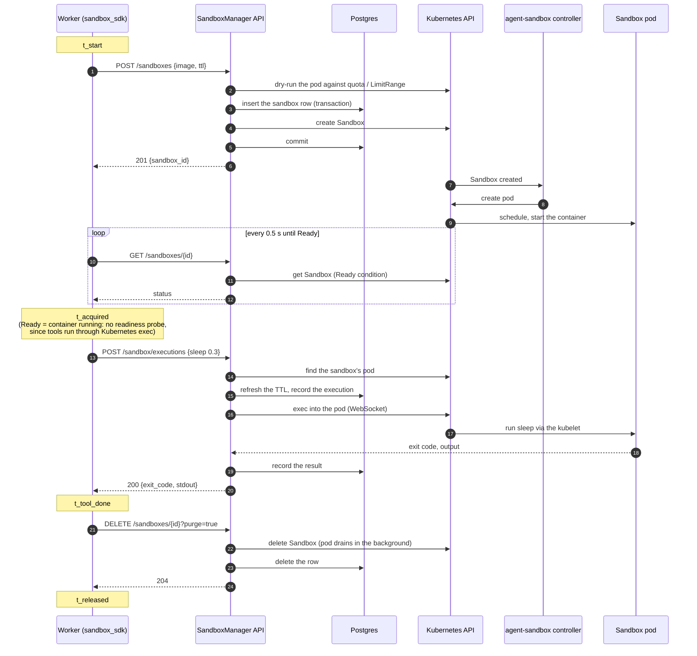

## 4. One tool call: agent-sandbox, cold start

The warm pool is at depth 0, so the claim makes the controller create a sandbox
from the template and wait for its runtime to answer.

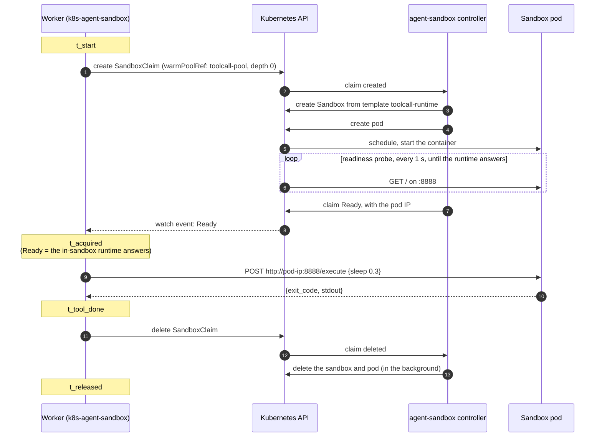

## 5. One tool call: agent-sandbox, warm pool

The pool keeps N sandboxes already running and Ready. A claim adopts one, so
acquiring skips pod creation and startup; the controller then starts a
replacement. When workers outpace the refill, the pool runs dry and claims fall
back to the cold path above.

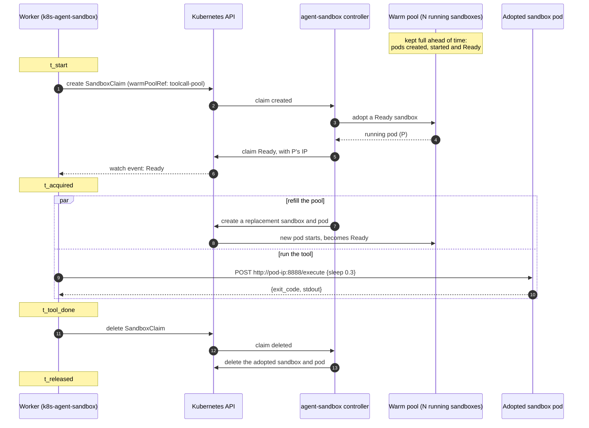

## 6. One tool call: reused sandbox

The upper bound. Each worker claims one sandbox before the measured run starts
and keeps it; every tool call is a single HTTP request. Acquire and release are
a handoff inside the worker, so they take no measurable time.

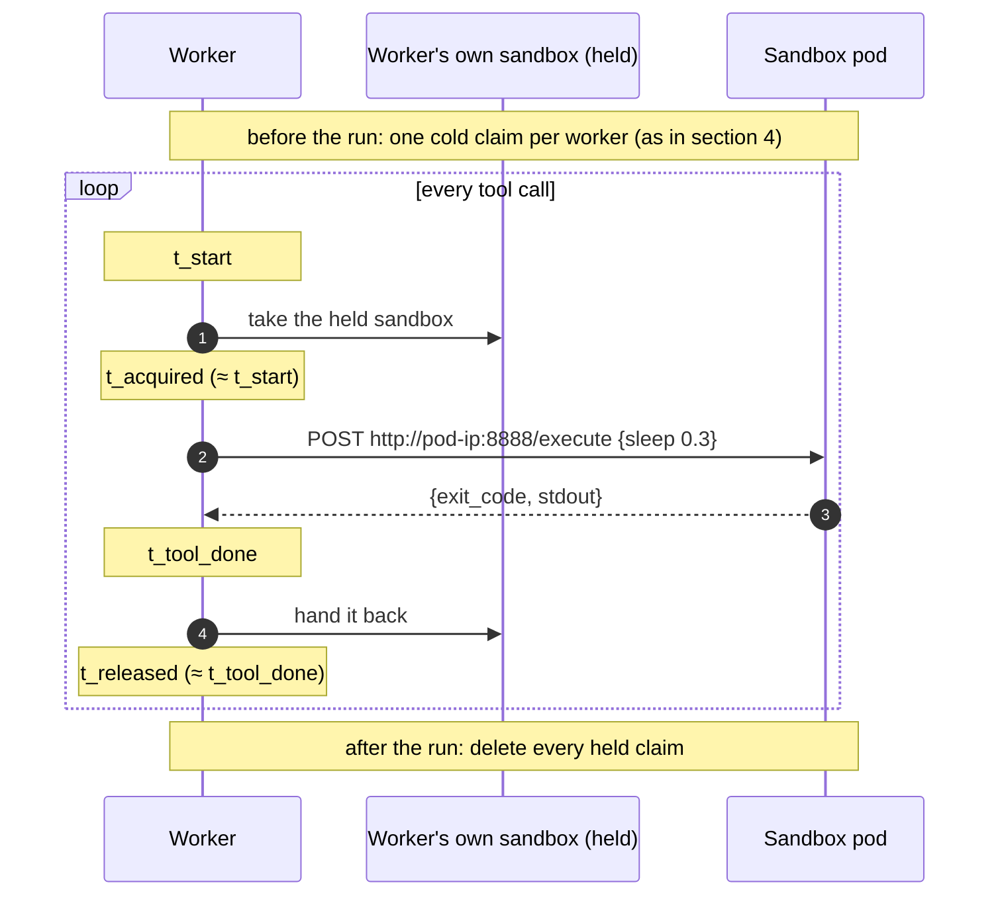

## 7. One worker's request pipeline, measured

Real tool calls from the closed-loop runs with 4 workers (small profile, Python
runtime, `results/2026-10-22_small_python-runtime/`), showing **worker 1** only:
the first 12 s after warm-up. A worker starts its next call as soon as the last
is released, so its row is a back-to-back chain of **acquire** (red), **tool**
(blue) and **release** (grey); the other three workers run the same kind of chain
alongside it. Times are seconds from the first measured call in the run.
Generated with `tools/timing-diagram.py --worker 1`.

SandboxManager: acquire is ~1 s while pod IPs last; some calls wait much longer
for one.

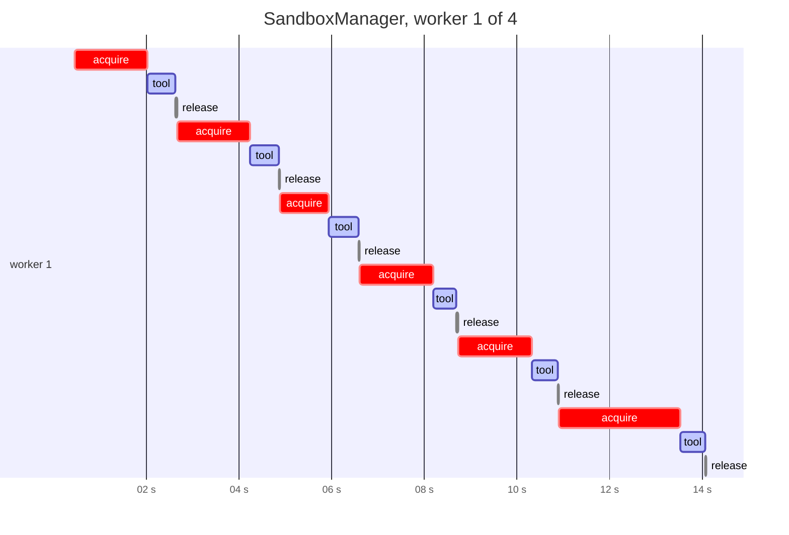

agent-sandbox, cold start: every call waits ~5–6 s for a sandbox whose runtime
answers.

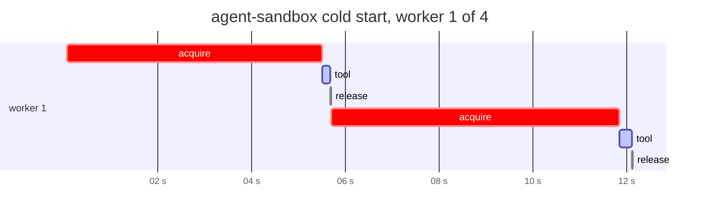

agent-sandbox with a warm pool of 32: while the pool lasts, acquire shrinks to a
sliver and the tool dominates; later calls wait for the pool to refill.

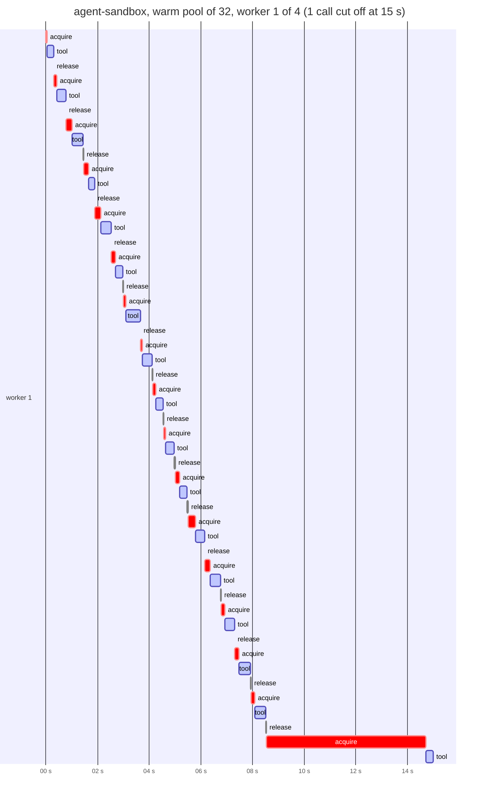

Reused sandbox (first 3 s; the chain is too dense to read at 12 s): no acquire
at all, so the worker runs a tool every ~0.3 s.

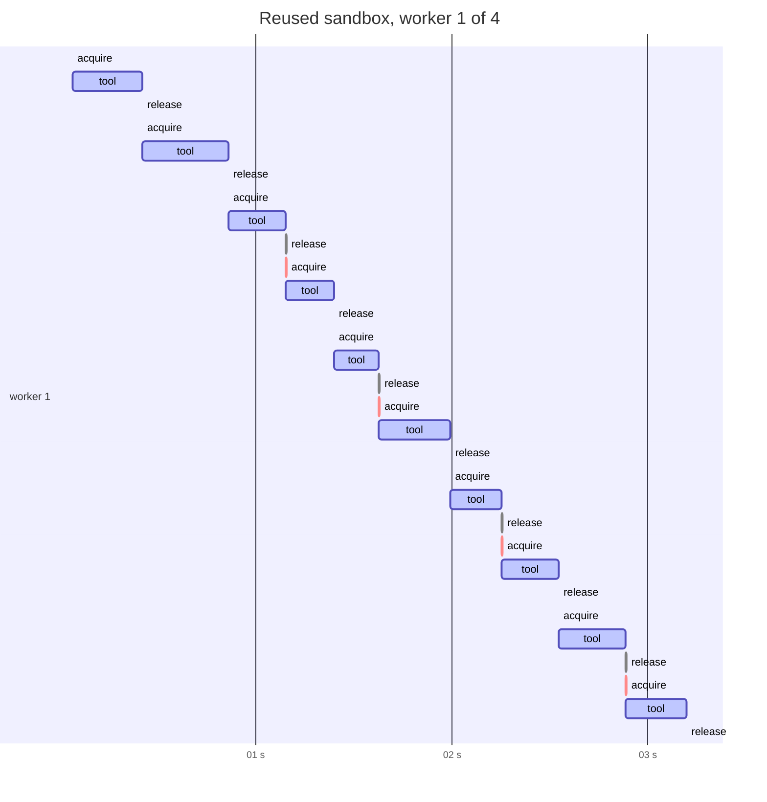

## 8. Open-loop arrivals, measured

Open loop has no workers. Calls arrive on a Poisson schedule at R calls/s
whether or not earlier calls have finished. Each arrival runs as its own task,
and at most MAX_INFLIGHT can be in flight. In the charts below calls are packed
into rows: a call takes the first row whose last call has finished. So the
number of rows is the peak number of calls in flight, and a growing staircase
means the arm is falling behind the offered rate. Data comes from the
agent-sandbox warm-pool sweep (pool of 32, Python runtime), from
`tools/timing-diagram.py --lanes`.

At 2 calls/s most acquires come straight from the pool (~60 ms) and calls
rarely overlap. The few slow acquires are claims that landed while the pool was
refilling.

```mermaid
gantt
    title agent-sandbox, warm pool of 32, open loop at 2 calls/s
    dateFormat YYYY-MM-DD HH:mm:ss.SSS
    axisFormat %S s
    tickInterval 2second
    section in flight 1
    acquire :crit, 2026-01-01 00:00:00.000, 2026-01-01 00:00:00.058
    tool :active, 2026-01-01 00:00:00.058, 2026-01-01 00:00:00.421
    release :done, 2026-01-01 00:00:00.421, 2026-01-01 00:00:00.430
    acquire :crit, 2026-01-01 00:00:00.476, 2026-01-01 00:00:00.532
    tool :active, 2026-01-01 00:00:00.532, 2026-01-01 00:00:00.931
    release :done, 2026-01-01 00:00:00.931, 2026-01-01 00:00:00.947
    acquire :crit, 2026-01-01 00:00:01.781, 2026-01-01 00:00:09.930
    tool :active, 2026-01-01 00:00:09.930, 2026-01-01 00:00:10.100
    release :done, 2026-01-01 00:00:10.100, 2026-01-01 00:00:10.110
    acquire :crit, 2026-01-01 00:00:10.112, 2026-01-01 00:00:10.181
    tool :active, 2026-01-01 00:00:10.181, 2026-01-01 00:00:10.492
    release :done, 2026-01-01 00:00:10.492, 2026-01-01 00:00:10.510
    acquire :crit, 2026-01-01 00:00:11.170, 2026-01-01 00:00:11.218
    tool :active, 2026-01-01 00:00:11.218, 2026-01-01 00:00:11.494
    release :done, 2026-01-01 00:00:11.494, 2026-01-01 00:00:11.506
    acquire :crit, 2026-01-01 00:00:11.542, 2026-01-01 00:00:11.662
    tool :active, 2026-01-01 00:00:11.662, 2026-01-01 00:00:11.990
    release :done, 2026-01-01 00:00:11.990, 2026-01-01 00:00:12.005
    section in flight 2
    acquire :crit, 2026-01-01 00:00:00.177, 2026-01-01 00:00:00.271
    tool :active, 2026-01-01 00:00:00.271, 2026-01-01 00:00:00.534
    release :done, 2026-01-01 00:00:00.534, 2026-01-01 00:00:00.574
    acquire :crit, 2026-01-01 00:00:00.680, 2026-01-01 00:00:07.854
    tool :active, 2026-01-01 00:00:07.854, 2026-01-01 00:00:08.199
    release :done, 2026-01-01 00:00:08.199, 2026-01-01 00:00:08.219
    acquire :crit, 2026-01-01 00:00:08.339, 2026-01-01 00:00:08.409
    tool :active, 2026-01-01 00:00:08.409, 2026-01-01 00:00:08.755
    release :done, 2026-01-01 00:00:08.755, 2026-01-01 00:00:08.781
    acquire :crit, 2026-01-01 00:00:09.324, 2026-01-01 00:00:09.391
    tool :active, 2026-01-01 00:00:09.391, 2026-01-01 00:00:09.722
    release :done, 2026-01-01 00:00:09.722, 2026-01-01 00:00:09.735
    acquire :crit, 2026-01-01 00:00:11.347, 2026-01-01 00:00:11.425
    tool :active, 2026-01-01 00:00:11.425, 2026-01-01 00:00:11.824
    release :done, 2026-01-01 00:00:11.824, 2026-01-01 00:00:11.855
    section in flight 3
    acquire :crit, 2026-01-01 00:00:00.567, 2026-01-01 00:00:06.716
    tool :active, 2026-01-01 00:00:06.716, 2026-01-01 00:00:07.113
    release :done, 2026-01-01 00:00:07.113, 2026-01-01 00:00:07.123
    acquire :crit, 2026-01-01 00:00:07.477, 2026-01-01 00:00:07.526
    tool :active, 2026-01-01 00:00:07.526, 2026-01-01 00:00:07.756
    release :done, 2026-01-01 00:00:07.756, 2026-01-01 00:00:07.784
    acquire :crit, 2026-01-01 00:00:07.842, 2026-01-01 00:00:07.906
    tool :active, 2026-01-01 00:00:07.906, 2026-01-01 00:00:08.181
    release :done, 2026-01-01 00:00:08.181, 2026-01-01 00:00:08.193
    acquire :crit, 2026-01-01 00:00:09.622, 2026-01-01 00:00:09.694
    tool :active, 2026-01-01 00:00:09.694, 2026-01-01 00:00:10.008
    release :done, 2026-01-01 00:00:10.008, 2026-01-01 00:00:10.033
    acquire :crit, 2026-01-01 00:00:11.418, 2026-01-01 00:00:11.530
    tool :active, 2026-01-01 00:00:11.530, 2026-01-01 00:00:11.871
    release :done, 2026-01-01 00:00:11.871, 2026-01-01 00:00:11.884
    section in flight 4
    acquire :crit, 2026-01-01 00:00:01.782, 2026-01-01 00:00:09.911
    tool :active, 2026-01-01 00:00:09.911, 2026-01-01 00:00:10.127
    release :done, 2026-01-01 00:00:10.127, 2026-01-01 00:00:10.157
    section in flight 5
    acquire :crit, 2026-01-01 00:00:02.458, 2026-01-01 00:00:06.603
    tool :active, 2026-01-01 00:00:06.603, 2026-01-01 00:00:07.003
    release :done, 2026-01-01 00:00:07.003, 2026-01-01 00:00:07.014
    section in flight 6
    acquire :crit, 2026-01-01 00:00:02.492, 2026-01-01 00:00:09.655
    tool :active, 2026-01-01 00:00:09.655, 2026-01-01 00:00:10.049
    release :done, 2026-01-01 00:00:10.049, 2026-01-01 00:00:10.064
    section in flight 7
    acquire :crit, 2026-01-01 00:00:02.632, 2026-01-01 00:00:10.043
    tool :active, 2026-01-01 00:00:10.043, 2026-01-01 00:00:10.391
    release :done, 2026-01-01 00:00:10.391, 2026-01-01 00:00:10.402
    section in flight 8
    acquire :crit, 2026-01-01 00:00:03.832, 2026-01-01 00:00:03.943
    tool :active, 2026-01-01 00:00:03.943, 2026-01-01 00:00:04.302
    release :done, 2026-01-01 00:00:04.302, 2026-01-01 00:00:04.317
    acquire :crit, 2026-01-01 00:00:05.172, 2026-01-01 00:00:07.298
    tool :active, 2026-01-01 00:00:07.298, 2026-01-01 00:00:07.708
    release :done, 2026-01-01 00:00:07.708, 2026-01-01 00:00:07.724
    section in flight 9
    acquire :crit, 2026-01-01 00:00:04.147, 2026-01-01 00:00:04.202
    tool :active, 2026-01-01 00:00:04.202, 2026-01-01 00:00:04.576
    release :done, 2026-01-01 00:00:04.576, 2026-01-01 00:00:04.586
    acquire :crit, 2026-01-01 00:00:06.042, 2026-01-01 00:00:06.100
    tool :active, 2026-01-01 00:00:06.100, 2026-01-01 00:00:06.534
    release :done, 2026-01-01 00:00:06.534, 2026-01-01 00:00:06.582
    section in flight 10
    acquire :crit, 2026-01-01 00:00:04.214, 2026-01-01 00:00:10.414
    tool :active, 2026-01-01 00:00:10.414, 2026-01-01 00:00:10.716
    release :done, 2026-01-01 00:00:10.716, 2026-01-01 00:00:10.727
    section in flight 11
    acquire :crit, 2026-01-01 00:00:06.475, 2026-01-01 00:00:10.609
    tool :active, 2026-01-01 00:00:10.609, 2026-01-01 00:00:10.922
    release :done, 2026-01-01 00:00:10.922, 2026-01-01 00:00:10.939
```

At 3 calls/s the controller can't refill the pool as fast as claims drain it.
Within seconds acquires wait for a cold start, calls pile up in flight, and
delivered throughput levels off at ~2.5 calls/s. The sweep keeps raising the rate
until delivered falls below half of offered.

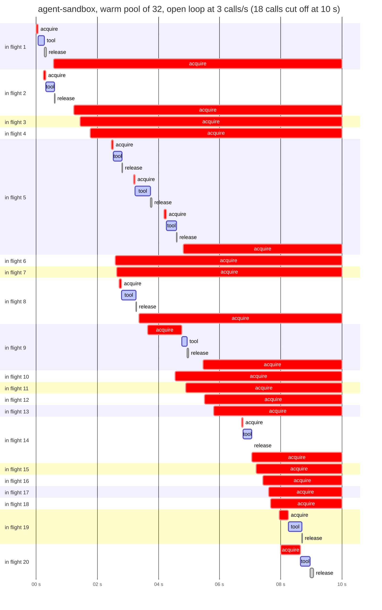

## 9. How stop signals propagate

A stop travels through three levels.
- **Harness process:** it stops starting new calls.
- **Cell:** the harness exits once the calls it already started have finished.
- **`run-matrix.sh`:** it records why the cell stopped and decides what runs next.

Nothing is ever cancelled mid-call, so every sandbox that was acquired is still
released: SandboxManager's DELETE, or deleting the agent-sandbox claim.

**The rules.** Each harness process keeps its own record of the calls it has
finished and the calls it has in flight. It checks two rules:
- `--max-error-rate`: more than 5% of the calls finished in the last 30 s
  failed, with at least 10 calls in that window.
- `--max-latency`: a call has been in flight for over 60 s.

The first rule that trips is latched for the rest of the cell. Its reason is
appended to `<out>.stop` as `proc N: …`.

**Scope.** The rules are local to each process. With `--procs` above 1, each
process stops on its own and the others carry on until their own rules trip or
the duration ends. The small loadgen pod has 2 CPUs, so the harness runs a
single process there (the default is one fewer than the CPUs).

**When the rules are checked** depends on the load mode:

| Mode | Checked | On stop | Not caught |
|---|---|---|---|
| Closed loop | By each worker, before it starts its next call | That worker exits once its current call finishes; the other workers exit at their next check | A slow call isn't seen until another worker comes round to check; with 1 worker, not until it finishes |
| Open loop | By the arrival loop, before each arrival | No new arrivals; calls in flight run to completion, then the harness exits | A call stuck in flight while no arrivals are due. Arrivals dropped at `--max-inflight` count as failures, so the in-flight cap usually trips the error rule within seconds |
| Burst | Never: all N calls start at once | — | Everything: a burst always runs to completion |

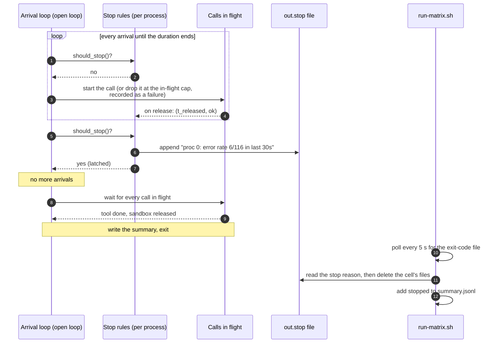

**Above the cell.** `run-matrix.sh` never kills a cell. It waits for the exit
code, so the stop reason only affects what happens next:

- A closed-loop or burst cell flagged as stopped doesn't change the grid. After
  the usual cooldown, the next cell runs.
- In a rate sweep, a stopped cell is judged like any other, on the calls it
  delivered before the stop. The sweep skips its remaining rates only when
  delivered throughput is below `SWEEP_FLOOR` (50%) of offered.
- The report shows "Stopped: yes" for such cells, with the reason on hover. Their
  numbers cover only the time up to the stop (and the drain after it), so a
  stopped cell's measured window is shorter than its `--duration`.

**Stopping a run by hand.** Each cell runs detached in the loadgen pod (under
`setsid`), so stopping `run-matrix.sh` on your machine doesn't stop the cell in
progress. That cell finishes, releases its sandboxes and leaves its files in
the pod's `/tmp`, where nothing collects them. Before starting the next run,
check that no claims or sandboxes are left:
`kubectl -n toolcall-bench get sandboxclaims,sandboxes`.

## Where the arms differ

| | SandboxManager | agent-sandbox |
|---|---|---|
| Acquire is done when | the container is running (no readiness probe) | the in-sandbox runtime answers on :8888 |
| A tool runs through | the API, then a Kubernetes exec stream via the kubelet | one HTTP request straight to the pod |
| Waiting for ready | client polls `GET /sandboxes/{id}` every 0.5 s | the SDK watches the claim |
| State it keeps | a Postgres row per sandbox and execution | Kubernetes objects only |

These differences show up in the results: SandboxManager is ready sooner with a
slow-starting runtime (it never waits for the runtime), while agent-sandbox's
run step is shorter (one HTTP request instead of an exec stream).
